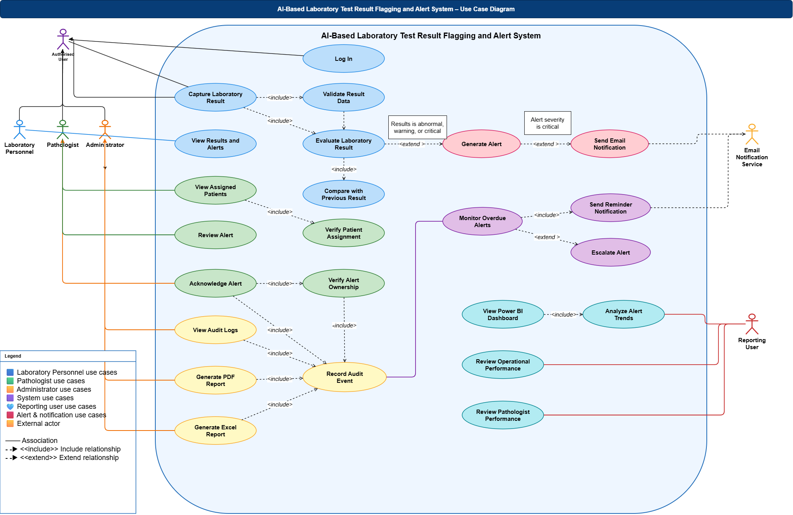
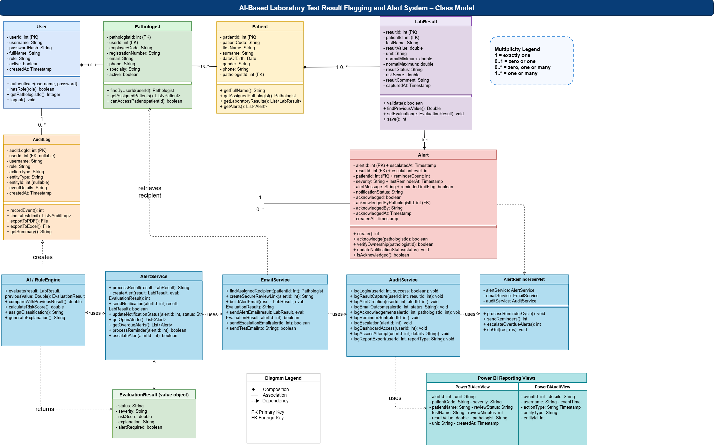
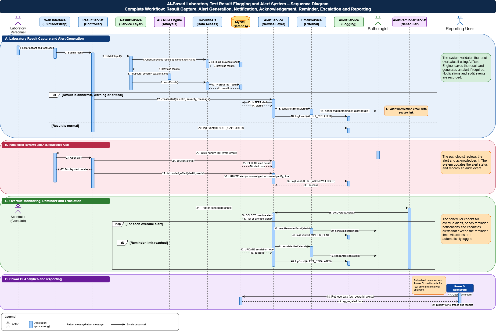
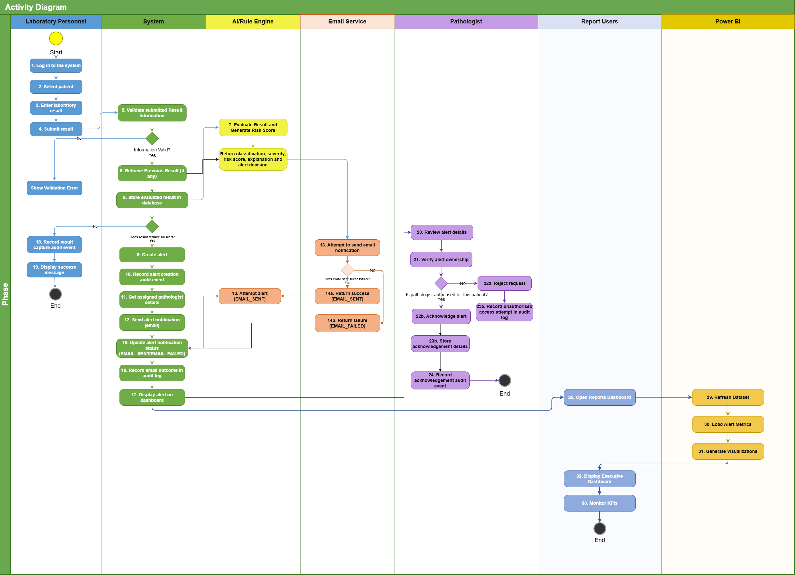
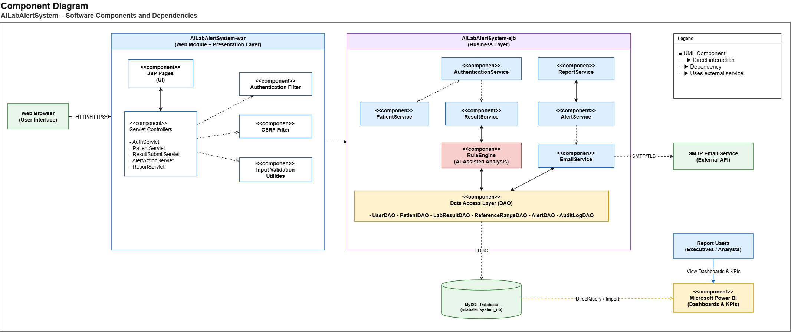
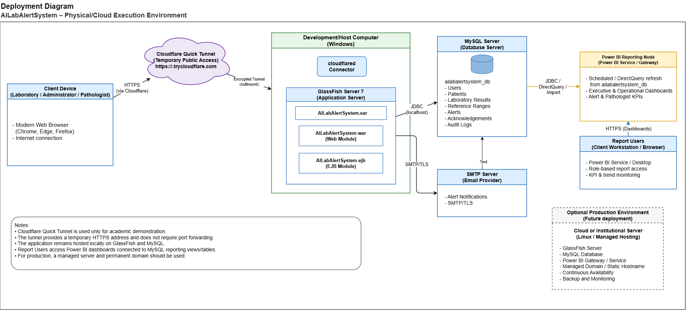

# AI Lab Alert Management System (AILabAlertSystem)

The **AI Lab Alert Management System (AILabAlertSystem)** is an intelligent healthcare application that automates the detection of abnormal laboratory test results, maintains audit records, and provides operational analytics through Microsoft Power BI.

It combines enterprise Java EE architecture, artificial intelligence, email notification services, audit logging, and business intelligence reporting to improve patient safety and clinical turnaround times.

---

## Technologies & Frameworks

- **Enterprise Java:** Jakarta EE, Servlets, EJB (`jakarta.ejb`, `jakarta.servlet`, `jakarta.mail`, `jakarta.persistence`)
- **Frontend:** HTML5, CSS3, JavaScript, Bootstrap
- **Database:** MySQL Server 8, MySQL Workbench, MySQL Connector/J
- **Email & Data Services:** Jakarta Mail API, Java Activation Framework, Gson (Google JSON Library)
- **Logging:** Java Util Logging
- **Business Intelligence:** Microsoft Power BI, DAX, Power Query
- **IDE & Server:** Apache NetBeans 22, GlassFish Server 7, Java JDK 17+

---

## AI Engine

The **AI Engine** evaluates incoming laboratory test results and automatically identifies critical patient conditions.

### Core AI Functions
- Laboratory result evaluation
- Normal range comparison
- Severity classification
- Risk scoring & critical value detection
- Alert prioritisation & decision support recommendations

### Risk Score Classification

| Risk Score | Risk Category | Alert Level |
| :--- | :--- | :--- |
| **0 – 30** | Low Risk | Normal |
| **31 – 60** | Moderate Risk | Warning |
| **61 – 80** | High Risk | High |
| **81 – 100** | Critical Risk | Critical |

---

## Database Design

The system uses a relational **MySQL** database with the following core tables:

- `patients` — Stores patient information.
- `test_results` — Stores laboratory test results.
- `alerts` — Stores generated alerts.
- `pathologists` — Stores pathologist accounts.
- `users` — Stores system users.
- `email_logs` — Stores email notification history.
- `audit_logs` — Stores audit trail records.

---

## Power BI Dashboards

- **Page 1 – Executive Overview:** Critical Alerts, Open Alerts, Overdue Alerts, Average Review Time
- **Page 2 – Live Operations:** Active Alerts, Department Monitoring, Real-Time Alert Status
- **Page 3 – Alert Detail:** Drill-through Analysis, Patient-level Alert Tracking
- **Page 4 – Audit Activity:** User Activity Monitoring, Compliance Reporting, Security Tracking

---
## System Architecture & UML Diagrams

### 1. Use Case Diagram


### 2. Class Model


### 3. Sequence Diagram


### 4. Activity Diagram


### 5.1. Component Architecture


### 5.2. Deployment Diagram


---
## Project Structure

```text
lab-alert-system/
├── AILabAlertSystem-ejb/
├── AILabAlertSystem-war/
├── Database/
│   ├── create_database
│   ├── create_tables
│   └── views
├── Documentation/
│   ├── AI Lab Alert System User Manual v1.pdf
│   ├── Installation Guide v1.pdf
│   ├── ISJ107V_Assignment5_Final_213213180.pptx
│   └── ISJ107V_Power_BI_Dasboard_Final_213213180.pptx
├── Image/
│   ├── lab_alert_activity_diagram.png
│   ├── lab_alert_class_model.png
│   ├── lab_alert_component_architecture.png
│   ├── lab_alert_deployment_diagram.png
│   ├── lab_alert_sequence_diagram.png
│   └── lab_alert_use_case_diagram.png
├── PowerBI/
│   └── AILabAlertSystem Dashboard.pbix
├── UML/
│   ├── lab_alert_activity_diagram.drawio
│   ├── lab_alert_class_model.drawio
│   ├── lab_alert_component_architecture.drawio
│   ├── lab_alert_sequence_diagram.drawio
│   └── lab_alert_use_case_diagram.drawio
├── nbproject/
├── src/
│   └── conf/
├── .gitignore
├── build.xml
├── README.md
└── reporting-libs-pom.xml
```

---

## Installation Requirements

### Software Requirements
- Java JDK 17+
- Apache NetBeans 22
- GlassFish Server 7
- MySQL Server 8
- MySQL Workbench
- Power BI Desktop

---

## Author

**L.T. Maduana**  
**213213180**  
Advanced Diploma in Computer Science  
Tshwane University of Technology (TUT)  
2026

---

## Project Objectives

The primary objective of this project is to improve patient safety and laboratory workflow efficiency through intelligent alert generation, automated notifications, audit compliance, and business intelligence reporting.

---

## Repository

- **GitHub Repository:** [https://github.com/Maduana/lab-alert-system](https://github.com/Maduana/lab-alert-system)
